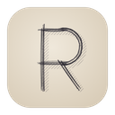
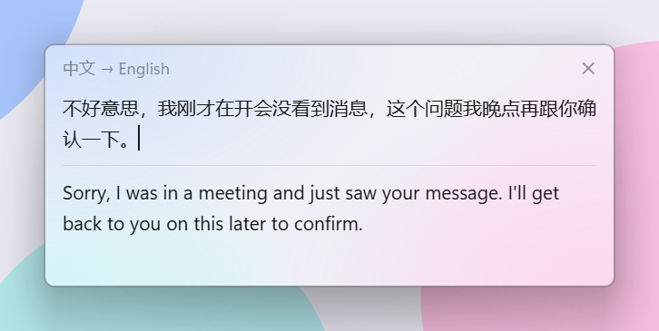
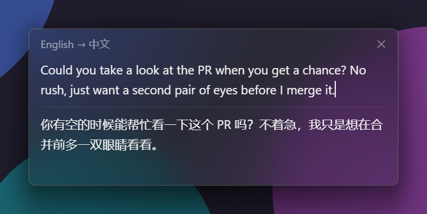
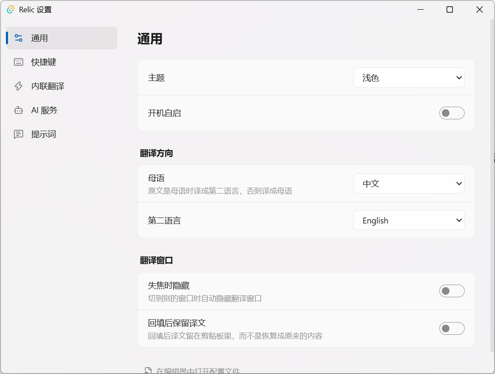

# Relic

English | [中文](README.zh-CN.md)

A small, fast translator for Windows that lives in the tray and stays out of your way. Select text anywhere and press a key, or type in Chinese and get natural, everyday English back without leaving the app you're in. Translations stream in as they're generated, and every AI request goes out from a local Rust process.

<p>
  
  
</p>

## What it does

- **Translate a selection.** Highlight text in any app and press `Alt+E`. The window pops up next to your cursor and starts translating. Relic reads the selection through UI Automation when it can, so your clipboard is left alone.
- **Translate what you type.** Press `Alt+F`, type, hit Enter.
- **Translate in place.** Tap `Alt` twice inside any text box and its contents are swapped for the English version — just the selection if there is one, otherwise the whole box. Handy when you're chatting in English but thinking in Chinese. In a terminal, Relic opens a small input box instead and pastes the result back for you.
- **Paste it back.** Copy the translation, or press `Ctrl+Enter` to drop it into the app you came from, replacing the original selection. The temporary clipboard content never shows up in Win+V history, and your previous clipboard is restored afterwards.
- **Picks the direction for you.** Text in your native language goes to your second language; everything else comes back to your native language. Click the language label to flip it.
- **Sounds like a person, not a textbook.** The default prompt asks for short sentences and the words native speakers actually use, so you pick up common phrasing as you go. You can rewrite the prompts in Settings.
- **Bring your own model.** OpenAI-compatible APIs (DeepSeek by default), Anthropic, and Gemini. Set up as many as you like and switch between them.
- **Looks at home on Windows 11.** Native acrylic blur and rounded corners, a light and a dark gradient theme (or follow the system), always on top, and the window grows with the text. Tray menu and launch at startup included.

## Shortcuts

| Where | Keys | Action |
|---|---|---|
| Anywhere | `Alt+E` (configurable) | Translate selection |
| Anywhere | `Alt+F` (configurable) | Open the translation window |
| Anywhere | Double-tap `Alt` | Translate in place (can be turned off) |
| Translation window | `Enter` / `Shift+Enter` | Translate / new line |
| Translation window | `Esc` | Cancel while translating, otherwise hide |
| Translation window | `Ctrl+C` | Copy the translation when nothing is selected |
| Translation window | `Ctrl+Enter` | Paste back into the previous app |

## Settings

Open them from the tray menu. Changes apply immediately. If you'd rather edit by hand, everything lives in `%APPDATA%\com.relic.app\config.toml`, and Relic reloads it as soon as you save. Comments you add there are kept when the app writes to the file.



The interface is in Chinese for now.

## Under the hood

| Layer | Choice |
|---|---|
| Shell | [Tauri v2](https://tauri.app) |
| UI | React 19, TypeScript, Tailwind CSS 4, Vite — no component or state libraries |
| Core | Rust: AI requests (reqwest with a small SSE parser), config (toml / toml_edit with hot reload), language detection (whatlang plus script-based rules) |
| Windows integration | `windows` crate: UI Automation, SendInput, a low-level keyboard hook, the Win32 clipboard, DWM corners and backdrop |
| Shared types | ts-rs generates the TypeScript types from Rust |
| Installer | NSIS, per-user, no admin rights needed |

Relic targets Windows 11 only — the core features depend on Win32. Design notes (in Chinese) are in [docs/design.md](docs/design.md).

## Building

You'll need Rust with the MSVC toolchain, Visual Studio Build Tools with the "Desktop development with C++" workload, Node.js, and pnpm.

```bash
pnpm install
```

```bash
pnpm tauri dev
```

To build the installer (it ends up in `src-tauri/target/release/bundle/nsis/`):

```bash
pnpm tauri build
```

Rust tests, which also regenerate the TypeScript bindings in `src/lib/bindings/`:

```bash
cd src-tauri && cargo test
```
